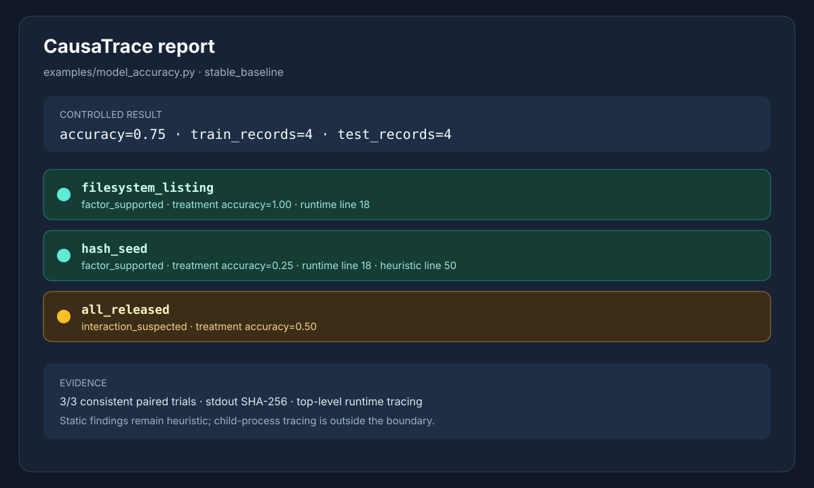

# CausaTrace

> An evidence-first causal reproducibility debugger for Python experiments.

[](https://github.com/Aryanbhargava18/CausaTrace/actions/workflows/ci.yml)
[](LICENSE)
[](.python-version)

When a Python experiment changes between runs, CausaTrace helps answer three
practical questions:

1. **Which tested runtime factor changed the result?**
2. **Where did that behavior enter the program?**
3. **Did the repair restore reproducibility?**

It investigates hidden execution factors such as hash randomization, random
number generators, filesystem ordering, and timezone. Rather than inferring a
cause from one trace, it runs controlled baseline and treatment trials,
records the evidence, and reports when the evidence is insufficient.

## What it does

- Establishes a repeated, pinned baseline before making a causal claim.
- Intervenes on one runtime factor at a time using paired trials.
- Compares stdout, stderr, exit status, artifacts, and numeric metrics.
- Combines runtime locations with clearly-labelled static heuristics.
- Suggests small source repairs and verifies them across repeated runs.
- Produces terminal, JSON, and self-contained HTML reports.
- Runs locally and offline after dependencies are installed.

## Quick start

Requirements: Python **3.12.8** and [`uv`](https://docs.astral.sh/uv/).

Install the locked development environment:

```bash
uv sync --locked --all-groups
```

Run the included demonstration:

```bash
make demo
```

Run the realistic offline data-science example:

```bash
make example
```

The demonstration uses a small set-order experiment. It changes
`PYTHONHASHSEED` in controlled trials, identifies the resulting output change,
shows the source location, verifies a stable control, and deliberately rejects
an unrepaired `random.random()` script. That expected rejection is important:
verification must not hide nondeterminism by applying CausaTrace's own seeds.

Run the test suite:

```bash
make test
```

## Offline model-accuracy example

`examples/model_accuracy.py` is a small but realistic failure mode for a data
science workflow. It loads labelled records from eight CSV files, uses the
first half as training data, fits a nearest-centroid classifier, and reports
test accuracy. The script contains two hidden assumptions:

- `os.listdir()` defines the train/test split, so filesystem order changes
  which records become training data.
- A tied prediction chooses the first label from a set, so `PYTHONHASHSEED`
  changes a model decision.

The example is intentionally dependency-light and offline. CausaTrace observes
both causes instead of treating a changed accuracy number as an unexplained
model problem:

```text
baseline:            accuracy=0.75
hash_seed treatment:  accuracy=0.25
listing treatment:    accuracy=1.00
all_released:         accuracy=0.50
```

Run the full controlled analysis yourself:

```bash
uv run --offline causatrace analyze examples/model_accuracy.py --project-root .
```

## Typical workflow

Analyze the checked-in model-accuracy example and choose a report format:

```bash
uv run --offline causatrace analyze examples/model_accuracy.py --project-root . \
  --metric-regex 'accuracy=(?P<accuracy>[0-9.]+)'
uv run --offline causatrace analyze examples/model_accuracy.py --format json \
  --metric-regex 'accuracy=(?P<accuracy>[0-9.]+)' > /tmp/report.json
uv run --offline causatrace analyze examples/model_accuracy.py --format html \
  --metric-regex 'accuracy=(?P<accuracy>[0-9.]+)' --output /tmp/report.html
```

Pass arguments to the target after `--`:

```bash
uv run --offline causatrace analyze examples/model_accuracy.py \
  --project-root . --metric-regex 'accuracy=(?P<accuracy>[0-9.]+)' -- input.csv
```

Preview a repair, apply it explicitly, then verify the result:

```bash
WORK="$(mktemp -d)"
cp tests/fixtures/hash_dependent_set.py "$WORK/unstable.py"
uv run --offline causatrace fix "$WORK/unstable.py" --project-root "$WORK"
uv run --offline causatrace fix "$WORK/unstable.py" --project-root "$WORK" --write
uv run --offline causatrace verify "$WORK/unstable.py" --project-root "$WORK"
```

`fix` is preview-only by default. `--write` is explicit; if verification fails,
the original source is restored. Verification requires five successful runs
with identical stdout, stderr, and requested artifact hashes.

## Evidence model

Each analysis follows the same controlled protocol:

1. **Baseline stability** — three pinned baseline runs must agree. If they do
   not, CausaTrace reports `baseline_unstable` and withholds attribution.
2. **Paired intervention** — each factor is tested through three baseline and
   treatment pairs.
3. **Treatment stability** — a treatment must produce a repeatable difference;
   a one-off change is not enough.
4. **Localization** — intercepted operations and bounded call stacks provide
   runtime locations. AST findings are labelled heuristic and are not treated
   as runtime proof.
5. **Audit output** — reports include factor profiles, hashes, metrics, exit
   status, timeout state, artifact state, and per-trial evidence without copying
   raw program output or secrets.

The result is deliberately narrow: changing factor **F** under the declared
protocol repeatedly changed output **O**. It is not a claim of universal causal
inference or a guarantee that untested factors are safe.

## Actual CausaTrace result

```text
CausaTrace report
Target: examples/model_accuracy.py
Status: stable_baseline

filesystem_listing [baseline:filesystem_listing]: factor_supported
Evidence: stdout SHA-256; metrics=accuracy; max metric Δ=0.25
Runtime location: examples/model_accuracy.py:18 (runtime_user, os.listdir)

hash_seed [baseline:hash_seed]: factor_supported
Evidence: stdout SHA-256; metrics=accuracy; max metric Δ=0.5
Runtime location: examples/model_accuracy.py:18 (runtime_user, os.listdir)
Static heuristic: examples/model_accuracy.py:50 (unordered set tie-break)

baseline accuracy=0.75
filesystem-listing treatment accuracy=1.00
hash-seed treatment accuracy=0.25
all-released interaction accuracy=0.50
```

The report also labels the `os.listdir()` and set-comprehension findings as
heuristics, while the repeated output changes are runtime evidence.

## Flaky pytest example

The repository includes a minimal test that assumes a stable set order. The
same test passes with one interpreter seed and fails with another:

```bash
PYTHONHASHSEED=0 uv run --offline pytest examples/flaky_pytest/test_order.py -q
# 1 passed

PYTHONHASHSEED=1 uv run --offline pytest examples/flaky_pytest/test_order.py -q
# 1 failed
```

The failure points to the assumption directly:

```text
examples/flaky_pytest/test_order.py:6: AssertionError
E       AssertionError: assert ('dog', 'cat') == ('cat', 'dog')
```

Run CausaTrace against the test file to see the factor and source finding:

```bash
uv run --offline causatrace analyze \
  examples/flaky_pytest/test_order.py --project-root .
```

## Supported factors

| Factor | What is varied |
|---|---|
| `PYTHONHASHSEED` | Hash-dependent ordering in a fresh interpreter |
| Python random | Module-level Python RNG state |
| NumPy random | Legacy generator and unseeded `default_rng()` when available |
| Filesystem listing | Supported listing hooks and their ordering |
| Timezone | `UTC`, `Asia/Kolkata`, `America/Los_Angeles`, and `Pacific/Kiritimati` |
| All released | An interaction profile that releases the tested controls together |

The default verification profile is intentionally unmasked: it uses UTC,
C.UTF-8, a different hash seed, shuffled listing order, and a minimal declared
environment, but does not seed Python or NumPy randomness.

## Additional commands

```bash
uv run --offline causatrace pytest --project-root .
uv run --offline pytest tests/integration/test_examples.py --junitxml=/tmp/causatrace-results.xml
uv run --offline causatrace junit /tmp/causatrace-results.xml --format json
uv run --offline causatrace compare-csv tests/fixtures/csv/baseline.csv tests/fixtures/csv/treatment.csv --key id
uv run --offline causatrace benchmark --project-root .
```

These commands support common data and test workflows without requiring a
service, account, or API key.

## Planted-fixture benchmark

The included benchmark covers eight deterministic cases: a clean control,
Python random, NumPy `default_rng()`, hash-dependent sets, filesystem listing,
timezone, environment variables, and an intentionally unstable baseline. Run
it with:

```bash
uv run --offline causatrace benchmark --project-root .
```

The current result is:

```text
[PASS] clean_control.py: expected=none, detected=none
[PASS] unseeded_python_random.py: expected=python_random, detected=python_random
[PASS] numpy_default_rng.py: expected=numpy_random, detected=numpy_random
[PASS] hash_dependent_set.py: expected=hash_seed, detected=hash_seed
[PASS] filesystem_listing.py: expected=filesystem_listing, detected=filesystem_listing
[PASS] timezone_date.py: expected=timezone, detected=timezone
[PASS] environment_variable.py: expected=none, detected=none
[PASS] baseline_flaky.py: expected=none, detected=none, status=baseline_unstable

Fixture cases passed: 8/8
```

## Reports and configuration

The CLI supports terminal, JSON, and self-contained HTML reports. JSON and HTML
reports are designed for review and archiving: they contain hashes, metrics,
factor classifications, source locations, and limitations rather than raw
program output.



The snapshot above reflects the checked-in model-accuracy example and shows the
two supported factors, their observed accuracy changes, and the interaction
profile. Generate a full HTML report locally with:

```bash
uv run --offline causatrace analyze examples/model_accuracy.py \
  --project-root . --format html --metric-regex 'accuracy=(?P<accuracy>[0-9.]+)' \
  --output /tmp/causatrace-report.html
```

CausaTrace requires no runtime secrets. `.env.example` is included as a safe
configuration template, and real `.env` files are ignored by Git.

## Reproducible development

The repository pins Python 3.12.8 in `.python-version` and commits `uv.lock`.
The standard checks are:

```bash
make test
make demo
```

For a clean-machine boundary, build and run the Docker image with networking
disabled:

```bash
docker build -t causatrace .
docker run --rm --network none causatrace
docker run --rm --network none causatrace make demo
docker run --rm --network none causatrace \
  python tests/docker/timezone_probe.py
```

The image uses Python 3.12 slim, installs `tzdata` and `make`, and installs the
locked environment. The container test runs without network access; the image
build may download its pinned base and build inputs.

## Deploying as a batch container

CausaTrace is a command-line batch tool rather than a long-running web service.
The Docker image is the deployment artifact:

```bash
docker build -t causatrace:0.1.0 .
docker run --rm --network none causatrace:0.1.0 make test
docker run --rm --network none \
  -v "$PWD:/workspace:ro" -w /workspace \
  causatrace:0.1.0 \
  causatrace analyze examples/model_accuracy.py --project-root /workspace
```

Build the image in a connected environment, then run it with `--network none`
in a worker or CI job when the analysis must be isolated from the network.

## Development provenance

The implementation was developed in OmniRush using four focused parallel
sessions with explicit file ownership. Each session was checked offline before
its milestone commit; later integration work was reviewed and tested on the
combined tree.

| OmniRush session | Owned implementation area | Milestone evidence |
|---|---|---|
| **Runner and shim (@general subagent)** | `runner.py`, `shim.py`, `boot.py`, `profiles.py`, `capture.py`, compatibility exports, and `tests/unit/runner/` | `348c649`; focused runner suite: 6 passed; full suite at that point: 7 passed |
| **Locator and static rules (@general subagent)** | `locator.py` and `tests/unit/locator/` | `9cb54f0`; focused locator suite: 3 passed; full suite at that point: 10 passed |
| **Attribution and reporting (@general subagent)** | `compare.py`, `attribution.py`, `reporting.py`, and `tests/unit/reporting/` | `eacf40f`; focused reporting suite: 4 passed; full suite at that point: 14 passed |
| **Fixtures and tests (@general subagent)** | `tests/fixtures/`, listing data, and `tests/integration/test_fixtures.py` | `d305bca`; fixture suite: 8 passed; full suite at that point: 22 passed |

The integration path then added orchestration, repairs, verification, reports,
the benchmark, and the reproducibility contract. Milestone commits include
`4abace0` for verification evidence, `b3b9183` for reproducibility compliance,
`5b69749` for the final Docker contract fix, and the current CI workflow runs
the locked environment before the offline checks.

Final verification is reproducible from a clean checkout:

```bash
uv sync --locked --all-groups
make judge
```

The last clean-clone Docker verification used a no-cache image build,
`docker run --network none` for the test suite and demo, the model-accuracy
analysis from a read-only workspace mount, and the timezone probe. It produced
**58 passed**, a successful demo and model report, and `timezone data available`.

## Where it fits

CausaTrace complements tools that observe or record known inputs:

- Test frameworks find failures and counterexamples.
- Experiment trackers record declared parameters, metrics, and runs.
- Environment capture tools package dependencies and execution context.

CausaTrace focuses on the missing step: controlled intervention on hidden
runtime factors and repeated evidence for the resulting explanation.

## Scope and limitations

- Python scripts and the top-level process are supported. Child-process tracing
  is intentionally unsupported and reported as a limitation.
- Local analysis is not a network or filesystem security sandbox. Use Docker
  with `--network none` for a clean-machine boundary.
- The factor inventory is finite. `factor_not_observed` means “not observed
  under the tested controls,” not “impossible in all environments.”
- GPU/CUDA, notebooks, distributed jobs, additional languages, and arbitrary
  third-party RNGs are out of scope.
- Fixture benchmarks measure planted cases, not real-world accuracy.

## Project layout

```text
src/causatrace/   runner, probes, attribution, reports, fixes, comparisons
examples/         offline model-accuracy and flaky-pytest examples
tests/            unit tests, integration tests, Docker probe, planted fixtures
docs/             report snapshot used in this README
Dockerfile        reproducible slim image with tzdata and offline test command
Makefile          test, demo, example, and repository checks
uv.lock           committed dependency lock
```

## License

MIT. See [LICENSE](LICENSE).
